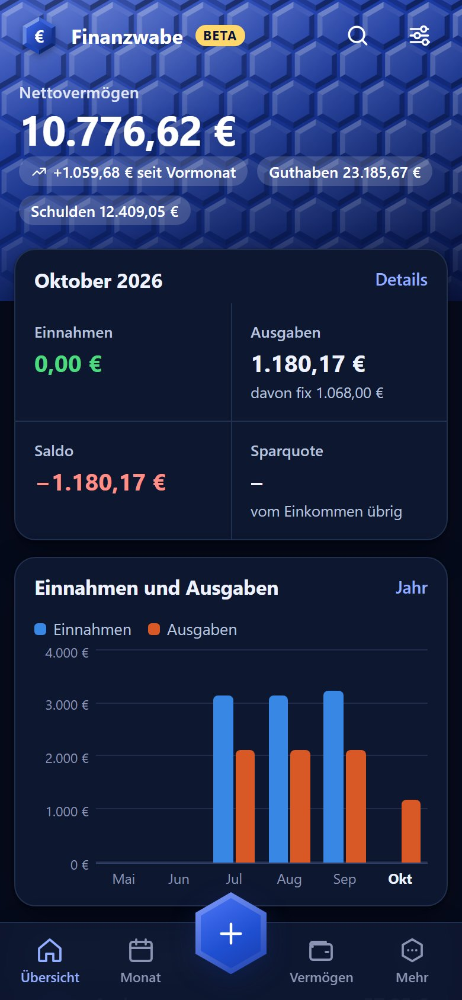
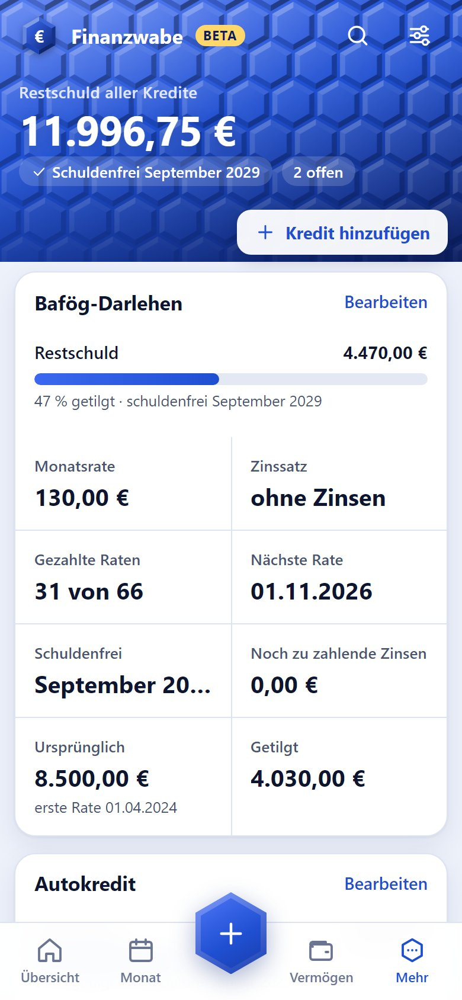
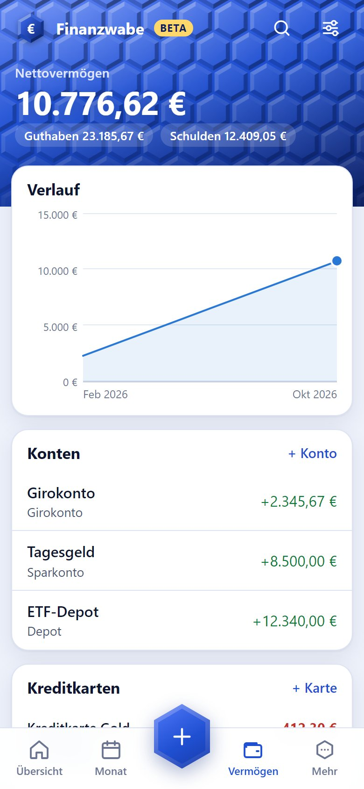
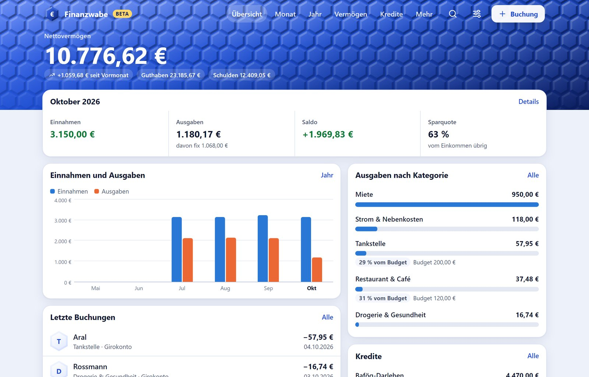

# Finanzwabe

**Wabe für Wabe schuldenfrei.** Finanz-App im Königsblau-Design mit 3D-Wabenstruktur. Sie ersetzt eine
selbst gebaute Excel-Tabelle und beantwortet drei Fragen auf einen Blick:

1. **Wofür gebe ich mein Geld aus?** Einnahmen und Ausgaben pro Monat, nach Kategorien, mit Budgets.
2. **Wie stehe ich insgesamt da?** Guthaben minus Schulden = Nettovermögen, mit Verlauf.
3. **Wie schnell baue ich Schulden ab?** Restschuld, Tilgung und „schuldenfrei am …“ pro Kredit.

Läuft im Browser am PC und auf dem Smartphone (Android und iPhone) als installierbare Web-App (PWA).

**Tech-Stack:** Python 3.12 · Flask · SQLAlchemy · SQLite · pytest · eigenes HTML/CSS ohne Frameworks

<p align="center">
  
  
  
</p>

<p align="center"></p>

<p align="center"><sub>Alle Screenshots zeigen erfundene Demo-Daten (<code>python serve.py --demo</code>).</sub></p>

## Funktionen

| Bereich | Was die App macht |
| --- | --- |
| Übersicht | Nettovermögen, Monatszahlen, Sparquote, Budget-Warnungen, 6-Monats-Diagramm, letzte Buchungen |
| Monat | Buchungen nach Tagen, Summen je Kategorie, Fixkosten, Filter per Klick auf eine Kategorie |
| Jahr | 12-Monats-Diagramm, Monatstabelle, Kategorien mit Monatsdurchschnitt, Vergleich zum Vorjahr |
| Vermögen | Konten, Kreditkarten mit freiem Rahmen, Kredite, Verlauf des Nettovermögens |
| Kredite | Restschuld, Fortschritt, nächste Rate, Zinsen, Prognose „schuldenfrei am …“ |
| Buchungen | Ausgabe, Einnahme oder Umbuchung zwischen eigenen Konten; Vorschläge aus früheren Buchungen |
| Daueraufträge | Miete, Gehalt, Abos, Kreditraten buchen sich jeden Monat selbst |
| Kategorien | Fixkosten-Haken (zählt trotzdem nur einmal) und Monatsbudget mit Warnung ab 80 % |
| Suche & Export | Suche nach Text, Kategorie oder Betrag; CSV-Export, der direkt in Excel aufgeht |
| Konto | Mehrere Nutzer mit Login, Passwort ändern und vergessen (E-Mail), alle Daten löschen |
| Excel-Import | Alte Tabelle mit Vorschau übernehmen: Buchungen, Kontostände, Kredite, Vermögensverlauf |
| Bank-Import | CSV-Export der Bank hochladen (Bankprofil wird an der Kopfzeile erkannt) oder Umsätze aus dem Online-Banking einfügen; liest PayPal-Händler, erkennt Doppelte (mit Kundenreferenz genau) und lernt Bezeichnung und Kategorie je Empfänger |
| Wabi | KI-Assistent: beantwortet Fragen zu deinen Zahlen, führt durch die App und schlägt Buchungen vor (siehe unten) |
| Start & Betrieb | Beta-Einladungscode, AGB-Zustimmung, Impressum/Datenschutz/AGB, Backups, Admin-Werkzeug |

## Schnellstart (Windows)

Doppelklick auf **`Finanzwabe_starten.bat`**. Beim ersten Mal richtet die Datei Python-Umgebung und Pakete
selbst ein. Danach öffnet sich der Browser mit `http://localhost:8000`. Registriere dich und leg los.

Frisch von GitHub, im Terminal (PowerShell):

```
git clone https://github.com/Soerenneumann1985/finanzwabe.git
cd finanzwabe
.\Finanzwabe_starten.bat
```

Oder von Hand im Projektordner:

```
py -3.12 -m venv .venv
.venv\Scripts\python -m pip install -r requirements.txt
.venv\Scripts\python serve.py
```

### Demo mit Beispieldaten

```
.venv\Scripts\python serve.py --demo
```

Startet mit einer eigenen Demo-Datenbank (`instance/demo.db`) und erfundenen Daten für vier Monate.
Die Demo-Anmeldung steht im Startfenster (und in `seed.py`). Deine echten Daten bleiben unberührt.

## Auf dem Smartphone nutzen

### Variante A: Zuhause im WLAN (sofort, kostenlos)

1. Am PC `Finanzwabe_starten.bat` ausführen. Das Fenster zeigt die Adresse fürs Handy,
   z. B. `http://192.168.178.23:8000`.
2. Beim ersten Start fragt die Windows-Firewall nach: **„Private Netzwerke“ erlauben**.
3. Am Handy (gleiches WLAN) die Adresse in Chrome öffnen und anmelden.
4. Chrome-Menü **⋮ → „Zum Startbildschirm hinzufügen“**. Das Wabensymbol liegt dann auf dem Startbildschirm.

Einschränkung: Das funktioniert nur, solange der PC läuft und du im selben WLAN bist. Ohne HTTPS legt
Chrome eine Verknüpfung an statt einer vollwertig installierten App.

### Variante B: Online mit HTTPS (überall, echte App-Installation)

Ausführliche Schritt-für-Schritt-Anleitung: **[DEPLOY.md](DEPLOY.md)**. Kurzfassung:

Empfohlen: **PythonAnywhere** mit Serverstandort EU (`eu.pythonanywhere.com`). SQLite-Daten bleiben
dort dauerhaft gespeichert, HTTPS ist inklusive.

1. Konto auf eu.pythonanywhere.com anlegen und das Projekt hochladen (am einfachsten per GitHub).
2. In einer Bash-Konsole dort: `python3.12 -m venv .venv && .venv/bin/pip install -r requirements.txt`
3. Unter *Web* eine neue Web-App mit *Manual configuration (Python 3.12)* anlegen,
   als Virtualenv `.venv` eintragen und in der WSGI-Datei `from wsgi import application` verwenden.
4. Unter *Web → Environment variables* bzw. in der WSGI-Datei setzen:
   - `FINANZ_SECRET_KEY` = langer Zufallswert (`python -c "import secrets; print(secrets.token_hex(32))"`)
   - `FINANZ_HTTPS=1` (Login-Cookie nur über HTTPS)
   - `FINANZ_BEHIND_PROXY=1`
   - `FINANZ_ALLOW_REGISTRATION=0`, wenn nur du dich anmelden sollst (vorher selbst registrieren)
5. *Force HTTPS* einschalten. Danach am Handy die Adresse öffnen, Chrome bietet **„App installieren“** an.

### Variante C: Google Play Store (später)

Sobald die App online mit HTTPS läuft, erzeugt [PWABuilder](https://www.pwabuilder.com) daraus ein
Android-Paket (Trusted Web Activity) für den Play Store. Am Code ändert sich dafür nichts.

## Wo liegen meine Daten?

`serve.py` zeigt beim Start immer an, welcher Ordner benutzt wird. Gesucht wird in dieser Reihenfolge:

1. der Ordner aus der Umgebungsvariable `FINANZ_DATA_DIR` (zum Beispiel ein Ordner in OneDrive),
2. ein Ordner `Finanzwabe` in deinem OneDrive, falls es ihn gibt,
3. `instance/` im Projekt, aber nur wenn dort von einer älteren Version schon eine `finanz.db` liegt,
4. sonst dein **Benutzerordner**: Windows `%LOCALAPPDATA%\Finanzwabe`, macOS
   `~/Library/Application Support/Finanzwabe`, Linux `~/.local/share/finanzwabe`.

Gibt es dort noch keine Datenbank, legt die App beim ersten Start eine leere an (und sagt es dir).
Zum Sichern genügt es, den angezeigten Ordner zu kopieren.

## Auf mehreren PCs nutzen (OneDrive)

1. In OneDrive einen Ordner `Finanzwabe` anlegen und `finanz.db` sowie `secret_key` aus deinem Datenordner
   (siehe oben) hineinkopieren (Rechtsklick auf den Ordner → *Immer auf diesem Gerät behalten*).
2. Auf jedem PC mit demselben Microsoft-Konto bei OneDrive anmelden und Finanzwabe wie gewohnt starten.
   `serve.py` findet den Ordner von selbst und zeigt beim Start `Daten (OneDrive): …` an.

Finanzwabe immer nur auf **einem** PC gleichzeitig laufen lassen und mit Strg+C beenden. Die Datei
`in_benutzung.txt` im OneDrive-Ordner warnt, falls die App auf einem anderen PC noch offen ist.
Ein anderer Ordner lässt sich mit `FINANZ_DATA_DIR` festlegen.

## Bank-Import (CSV)

Unter **Mehr → Bank-Import** lädst du den CSV-Export deiner Bank hoch. Danach siehst du jede Buchung in
einer Vorschau, erst dort wird gespeichert.

1. **Bankprofil:** Die App erkennt die Bank an der Kopfzeile der Datei. Ein Profil (`bank_profile/*.json`)
   beschreibt Zeichensatz, Trennzeichen, Dezimaltrenner, Datumsformat und die Spalten.
2. **Unbekannte Datei:** Passt kein Profil, rät die App nichts. Sie zeigt die gefundenen Spalten, du ordnest
   Datum, Betrag, Empfänger, Verwendungszweck und Kundenreferenz zu und kannst das als neues Profil speichern.
3. **Zeichensatz:** Erst UTF-8 (mit oder ohne BOM), sonst der Zeichensatz des Profils (Windows-1252).
   Umlaute in der Kopfzeile dürfen auch als `ae`/`oe`/`ue` oder als zerstörtes Zeichen � vorkommen.
4. **PayPal:** Steht als Empfänger nur PayPal, liest die App den Händler aus dem Verwendungszweck
   (vier bekannte Schreibweisen). Erkennt sie keine, gilt die normale Kategorie-Logik („Sonstiges“).
5. **Doppelte:** Hat die Datei eine Kundenreferenz, zählt nur sie. Dieselbe Referenz ist schon gebucht,
   drei Buchungen über je 200,00 € am selben Tag mit verschiedenen Referenzen bleiben drei Buchungen.
   Ohne Referenz gilt wie bisher: gleicher Betrag, höchstens 3 Tage Abstand.
6. **Lernen:** Bezeichnung und Kategorie, die du in der Vorschau wählst, schlägt die App beim nächsten
   Import für denselben Empfänger oder Händler wieder vor.

| Bank | Profil | Stand |
| --- | --- | --- |
| OLB (Oldenburgische Landesbank) | `bank_profile/olb.json` | mit einem echten Export geprüft |
| andere Banken | selbst anlegen im Zuordnungs-Dialog | Spalten einmal zuordnen, als Profil speichern |

Die Kundenreferenz steht in der neuen Spalte `transaction.customer_reference` (optional, wird beim Start
automatisch ergänzt). CSV-Dateien mit echten Kontodaten gehören nie ins Repository; `.gitignore` schließt
CSV, Excel und `.env` aus.

## Wabi, der KI-Assistent

Die kleine Roboterbiene neben dem Logo ist dein Finanz-Assistent. Antippen – Wabi fliegt nach unten rechts
und öffnet das Chatfenster. Plan und Stand der Umsetzung: [WABI_PLAN.md](WABI_PLAN.md).

| Was Wabi kann | Beispiel |
| --- | --- |
| Fragen zu deinen Finanzen beantworten | „Wie viel habe ich im Oktober für Supermarkt ausgegeben?“, „Wann bin ich schuldenfrei?“ |
| Durch die App führen, mit Link-Knopf | „Wo trage ich einen Dauerauftrag ein?“, „Zeig mir den Oktober“ |
| Buchungen vorschlagen | „Trag 23,50 € Tankstelle von heute ein.“ → Vorschau-Karte mit **Bestätigen**, **Ändern**, **Abbrechen** |
| Spracheingabe | Mikrofon-Knopf antippen und die Frage sprechen |

**Sicherheit:** Wabi bekommt keinen Zugriff auf die Datenbank, sondern nur einige Werkzeuge in `wabi.py`, die
über `services.py` ausschließlich die Daten des angemeldeten Nutzers lesen. Gespeichert wird eine Buchung erst,
wenn du auf der Karte „Bestätigen“ tippst; der Server prüft sie dann noch einmal mit den Regeln des
Buchungsformulars. Wabi kann nichts löschen, keine Buchungen ändern und keine Einstellungen ändern.

**Datenschutz:** Deine Frage und die Zahlen, die für die Antwort nötig sind, gehen an Claude (Anthropic) in der
Cloud – nie die ganze Datenbank. Der Chatverlauf liegt nur im Browser und ist nach dem Verlassen der Seite weg.
Die Spracheingabe nutzt die Spracherkennung des Browsers; Chrome schickt die Aufnahme dafür an Google.
Beides steht beim ersten Öffnen im Chatfenster.

### Einrichten

Wabi nutzt **deinen eigenen** Anthropic-Schlüssel. Es wird kein Schlüssel mitgeliefert, und die **Kosten der
KI-Anfragen trägst du selbst** (Abrechnung über das Guthaben bei Anthropic, nicht über ein Claude-Abo).

1. In der [Claude Console](https://console.anthropic.com) einen API-Schlüssel anlegen und Guthaben aufladen.
2. In Finanzwabe **Einstellungen → Wabi – KI-Assistent** öffnen, den Schlüssel einfügen und speichern.
   Neu starten ist nicht nötig. Nur das erste Konto der Installation darf den Schlüssel ändern.

Der Schlüssel liegt als Datei `anthropic_api_key` in deinem Datenordner (siehe „Wo liegen meine Daten?“),
also auf diesem Gerät und nie im Projekt. Wer OneDrive nutzt, hat ihn damit auf allen PCs. Alternativ geht die
Umgebungsvariable `ANTHROPIC_API_KEY`; sie hat Vorrang und lässt sich in den Einstellungen nicht ändern.

Ohne Schlüssel läuft die App ganz normal weiter. Wabi ist dann ausgeschaltet: Das Chat-Fenster ist gesperrt und
erklärt, woher man den Schlüssel bekommt und dass man die Kosten selbst trägt. Der Schlüssel wird nie
angezeigt, protokolliert oder ins Repository geschrieben (`.gitignore` schließt Schlüsseldateien aus).

### Kosten und Modell

Wabi nutzt das günstige Modell `claude-haiku-5-5` (Konstante `MODEL` in `wabi.py`, dort auch `EFFORT`).
Eine Frage kostet meist weniger als einen Zehntelcent. Kosten halten klein: kurze Systemanweisung, kompakte
Werkzeug-Antworten, höchstens 12 Nachrichten Verlauf pro Anfrage, Nachrichten auf 1.000 Zeichen gekürzt.

### Grenzen

- **Spracheingabe nur auf sicheren Seiten:** Browser erlauben das Mikrofon nur mit HTTPS oder auf
  `localhost`. Am PC (`http://localhost:8000`) geht es, auf dem Handy im Heim-WLAN (`http://192.168…`) blendet
  die App den Knopf aus – dort erst mit HTTPS (siehe *Variante B*).
- Antworten mit Auswertungen dauern meist 3 bis 15 Sekunden.
- Wabi antwortet nur per Text, nicht per Sprache.

## Einstellungen über Umgebungsvariablen

| Variable | Bedeutung | Standard |
| --- | --- | --- |
| `FINANZ_DATABASE_URL` | Datenbank | `finanz.db` im Datenordner (siehe „Wo liegen meine Daten?“) |
| `FINANZ_SECRET_KEY` | Schlüssel für das Login-Cookie | wird als `secret_key` im Datenordner erzeugt |
| `FINANZ_DATA_DIR` | Ordner für `finanz.db` (z. B. für mehrere PCs) | `OneDrive\Finanzwabe`, falls vorhanden, sonst der Benutzerordner |
| `FINANZ_ALLOW_REGISTRATION` | `0` = keine neuen Registrierungen | `1` |
| `FINANZ_HTTPS` | `1` = Cookie nur über HTTPS | aus |
| `FINANZ_BEHIND_PROXY` | `1` hinter einem Hosting-Proxy | aus |
| `FINANZ_INVITE_CODE` | Registrierung nur mit diesem Code (Beta) | leer = offen |
| `FINANZ_BETA` | `0` blendet das Beta-Abzeichen aus | `1` |
| `FINANZ_PUBLIC_URL` | Adresse der App, für Links in E-Mails | – |
| `FINANZ_OPERATOR_NAME`, `…_ADDRESS`, `FINANZ_CONTACT_EMAIL` | Angaben für Impressum und Datenschutz | Platzhalter |
| `FINANZ_SMTP_HOST`, `…_PORT`, `…_USER`, `…_PASSWORD`, `FINANZ_MAIL_FROM` | E-Mail-Versand für „Passwort vergessen“ | aus |

## Tests

```
.venv\Scripts\python -m pytest
```

Rund 250 Tests: jede Rechenregel einzeln (`tests/test_calculations.py`), Geldformat, Diagramme und die
ganze Web-App (Login, alle Seiten, Buchungen, Umbuchungen, Daueraufträge, Datentrennung zwischen Nutzern,
Schutz vor gefälschten Formularen) sowie Wabi mit nachgebildeter Claude-API (`tests/test_wabi.py`).

## Projektstruktur

```
finanz-app/
├── app.py              # Flask-App: Konfiguration, Sicherheit, Vorlagen-Helfer
├── models.py           # Tabellen (SQLAlchemy): user, account, category, transaction, recurring, loan, net_worth_snapshot
├── calculations.py     # ALLE Rechenregeln als reine Funktionen (ohne Datenbank, ohne Web)
├── services.py         # Datenbankabfragen pro Nutzer, reicht Werte an calculations.py weiter
├── wabi.py             # Wabi: API-Schlüssel, Werkzeuge und Gespräch mit Claude (Endpunkt: views/assistant.py)
├── bank_import.py      # Bank-Import: Profile, CSV lesen, PayPal-Händler, Doppelte, Vorschläge
├── bank_profile/       # Bankprofile (olb.json): nur Spaltennamen und Formate, keine Daten
├── money.py            # Beträge lesen ("1.234,56") und anzeigen
├── charts.py           # Positionen für die Diagramme (reines Layout)
├── icons.py            # Symbole als SVG
├── views/              # Seiten, eine Datei pro Bereich (auth, overview, transactions, …)
├── templates/          # HTML-Vorlagen (Jinja)
├── static/             # CSS, JavaScript, Wabenmuster, App-Symbole, Manifest, Service Worker
├── tools/make_graphics.py  # erzeugt Wabenmuster und App-Symbole neu
├── seed.py             # erfundene Demo-Daten
├── serve.py            # Start für den Alltag (PC + Handy im WLAN)
├── wsgi.py             # Start beim Hosting
└── tests/
```

## Rechenregeln

Alle Regeln stehen in `calculations.py`, jede mit eigenem Test. Beträge sind immer ganze Cent.

| Wert | Regel |
| --- | --- |
| Einnahmen / Ausgaben | Summe der Buchungen mit Kategorie-Art Einnahme bzw. Ausgabe |
| Fixkosten | Ausgaben mit Fixkosten-Haken, jede Buchung zählt genau einmal |
| Saldo | Einnahmen minus Ausgaben, Umbuchungen zählen nicht |
| Kontostand | Startwert + Buchungen auf dem Konto − Umbuchungen, die dort eingehen |
| Freier Kreditkartenrahmen | Limit + Kontostand (Stand ist negativ) |
| Restschuld ohne Zinsen | Startbetrag − Rate × gezahlte Monate, mindestens 0 (wie in Excel) |
| Restschuld mit Zinsen | jeden Monat Zinsen auf die Restschuld aufschlagen, dann Rate abziehen |
| Nettovermögen | positive Kontostände − negative Kontostände − Restschulden |

## Abweichungen vom ursprünglichen Konzept

- **Benutzerkonten von Anfang an** (eigentlich Stufe 5): Für Handy, Hosting und Verkauf nötig und
  später nur mühsam nachzurüsten.
- **Kontostand wird berechnet** statt fest gespeichert: Beim Bearbeiten trägst du den aktuellen Stand
  ein, spätere Buchungen verändern ihn automatisch. So kann er nie „auseinanderlaufen“.
- **Kredite ohne eigenes Kreditkonto**: Die Restschuld kommt direkt aus der Kreditberechnung,
  `loan.account_id` ist entfallen. Neu: optionaler Zinssatz.
- **Umbuchungen mit Zielkonto**: Girokonto → Sparkonto verschiebt Geld zwischen zwei eigenen Konten.
- **Diagramme ohne Chart.js**: eigene HTML/CSS-Diagramme. Sie laden nichts von fremden Servern
  (Datenschutz) und funktionieren ohne Internet.
- Aus den Ausbaustufen 2–4 schon enthalten: Diagramme, Jahresübersicht, Daueraufträge, Budgets,
  Kredite mit Zinsen und Prognose.

## Nächste Schritte

Der persönliche Startplan liegt bewusst nicht im Repository.


- Datenbank-Migrationen (Alembic), bevor sich Tabellen ändern, in denen schon echte Daten stehen.
  Bis dahin ergänzt `add_missing_columns()` in `models.py` beim Start nur neue, optionale Spalten
  (zuletzt `transaction.customer_reference`, die Kundenreferenz aus dem Bank-Import). Alles andere
  (Spalten löschen oder umbenennen, Pflichtfelder) braucht weiterhin eine echte Migration.
- Vor dem Verkauf: Impressum, Datenschutzerklärung, AGB, Auftragsverarbeitungsvertrag mit dem Hoster,
  automatische Backups, E-Mail-Bestätigung und „Passwort vergessen“, Bezahlmodell.

## Sicherheit und Datenschutz

- Passwörter nur als Hash (scrypt), Login-Sperre nach vielen Fehlversuchen.
- Schutz vor gefälschten Formularen (CSRF-Token) und strenge Content-Security-Policy.
- Jede Datenbankabfrage filtert nach dem angemeldeten Nutzer; Tests prüfen, dass niemand fremde Daten sieht.
- Seiten mit Finanzdaten werden nie zwischengespeichert, auch nicht offline auf dem Handy.
- Keine Tracker, keine externen Schriftarten oder Skripte.
- Echte Daten (Benutzerordner, `instance/`, `*.db`, Excel- und CSV-Dateien) sind per `.gitignore` vom Repository ausgeschlossen.
